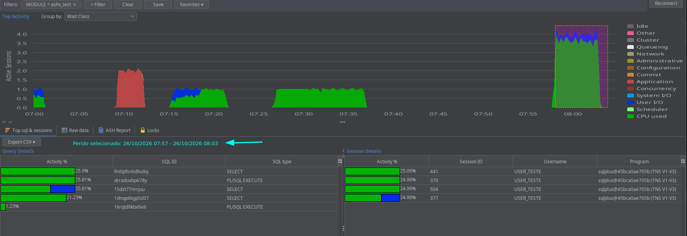

<p align="center"></p>

<h1 align="center">MP-ASH-Viewer</h1>

Active Session History for Oracle, **including Standard Edition and without the Diagnostics Pack**: the app samples
the active sessions every second, keeps them in a local history and shows them live, as history and as a comparison
of two periods.

MP-ASH-Viewer is a fork of [ASH Viewer](https://github.com/akardapolov/ASH-Viewer) by Alexander Kardapolov
(discontinued), extended and maintained by Marco Pontes.



## Main features

- **Top Activity**: active sessions by wait class, live, with Top SQL and Top sessions of any selected range
- **Filters**: by any collected column (module, username, machine, SQL_ID...), with favorites; "Group by" any column
- **History**: the local history of every connection, back to any day it was collected
- **Compare**: two periods side by side (before / after a deploy, yesterday x today, two runs of a batch), by wait
  class and by SQL_ID, module, session...; detects **execution plan changes** and tells whether a SQL went up
  because it ran **more times** or **slower**
- **Locks**: blocking tree live and in the history, with the final blocker and the wait it caused
- **Now: Sessions / Now: Resources**: a live view of the database: sessions, locks, long operations, jobs, PGA,
  TEMP, UNDO, tablespaces, FRA, Data Guard
- **SQL text** of every SQL_ID kept in the local history, also after it leaves the shared pool
- **Admin**: disk usage of the local histories, purge (manual or automatic), **backup and import** of a period to
  share with another analyst
- English and Portuguese, light, dark and classic themes

More details, screenshots and the limits of the sampling: [docs/FEATURES.md](docs/FEATURES.md).

## Supported databases

| Database | Status |
|---|---|
| **Oracle** 11.2 or later, Standard and Enterprise Edition, CDB / PDB | Developed and tested on 19c (OracleSE profile) |
| **PostgreSQL** | Only the collection inherited from the original ASH Viewer (Top Activity, History). The features of this fork were **not developed for PostgreSQL yet**: it is the next planned phase |
| **MySQL** | Being evaluated |

Oracle RAC: open one connection (one app) per instance.

## Quick start

1. Download the latest release from the [Releases page](https://github.com/mpontes-stack/MP-ASH-Viewer/releases):
   the application jar and `bc-fips-1.0.2.4.jar`, kept in the same folder.
2. Download the JDBC driver: [Oracle (ojdbc8.jar or later)](https://www.oracle.com/database/technologies/appdev/jdbc-downloads.html)
   or [PostgreSQL](https://jdbc.postgresql.org/download.html).
3. Run it with Java 11 or later:
   ```bash
   java -Xmx256m -jar ashv-4.0-SNAPSHOT-jar-with-dependencies.jar
   ```
4. In the connection dialog, create a connection: URL `jdbc:oracle:thin:@host:port/service` (or `:SID`), user,
   password, the JDBC driver jar and the profile **OracleSE** (samples `v$session`, no license needed).
5. Click **Connect**. The history is kept in `database/` next to the jar.

## Database privileges

The monitoring user only reads the dictionary. The simplest is:

```sql
CREATE USER ashv IDENTIFIED BY "<password>";
GRANT CREATE SESSION, SELECT_CATALOG_ROLE TO ashv;
```

In a container database create the user in the PDB you monitor (or a common user `C##ASHV` to monitor the root).
To grant only what the app reads, view by view, use [docs/ashv-grants.sql](docs/ashv-grants.sql).

**Licensing (Oracle):** the **OracleEE** profile reads `v$active_session_history` and the **ASH Report** tab calls
`DBMS_WORKLOAD_REPOSITORY`: both are part of the Oracle **Diagnostics Pack** (Enterprise Edition). Without that
license use the **OracleSE** profile and do not use the ASH Report tab.

The collection runs a light query every second (on `v$session` and, for the plan of the running SQL, a lookup in
`v$sql` by SQL_ID). Details of every query: [docs/FEATURES.md](docs/FEATURES.md#what-the-app-reads-from-the-database).

## Build

Requires JDK 11 or later and Maven:

```bash
mvn -q package -DskipTests
# ashv/target/ashv-4.0-SNAPSHOT-jar-with-dependencies.jar
```

## Credits

- [ASH Viewer](https://github.com/akardapolov/ASH-Viewer) by Alexander Kardapolov, the base of this fork
- [JFreeChart](https://www.jfree.org), [E-Gantt](https://github.com/akardapolov/ASH-Viewer/tree/master/egantt),
  [Berkeley DB Java Edition](https://www.oracle.com/database/technologies/related/berkeleydb.html), SwingX, FlatLaf,
  MigLayout, LGoodDatePicker, Dagger 2, Bouncy Castle FIPS, SnakeYAML

## License

GNU General Public License v3.0 (see [LICENSE](LICENSE)), the license of the original ASH Viewer.

## Contact

Marco Pontes · [marco.pontes.app@gmail.com](mailto:marco.pontes.app@gmail.com) ·
[issues](https://github.com/mpontes-stack/MP-ASH-Viewer/issues)
