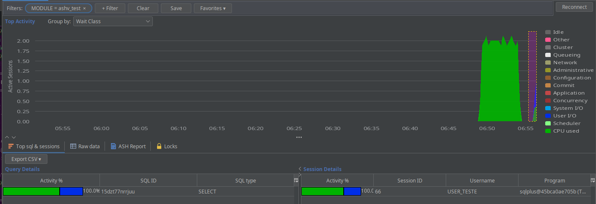
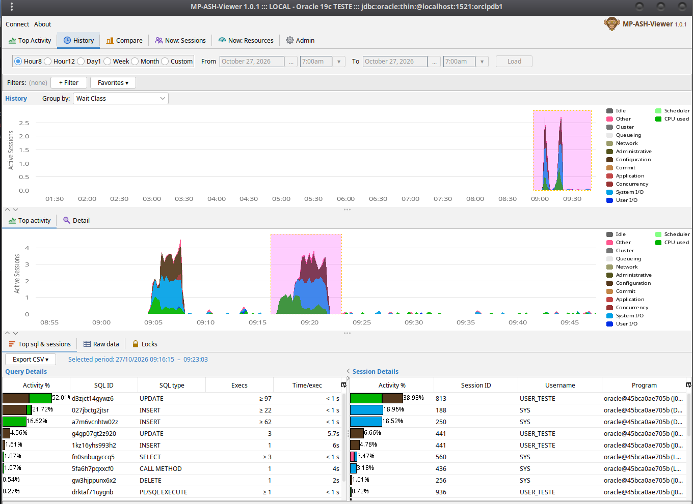
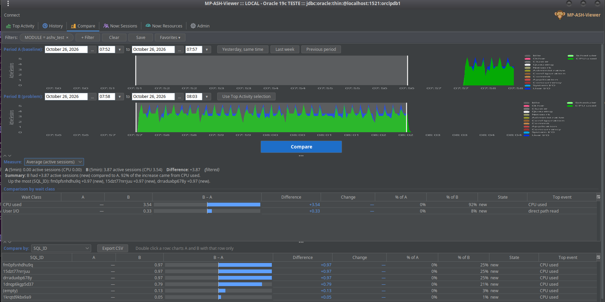
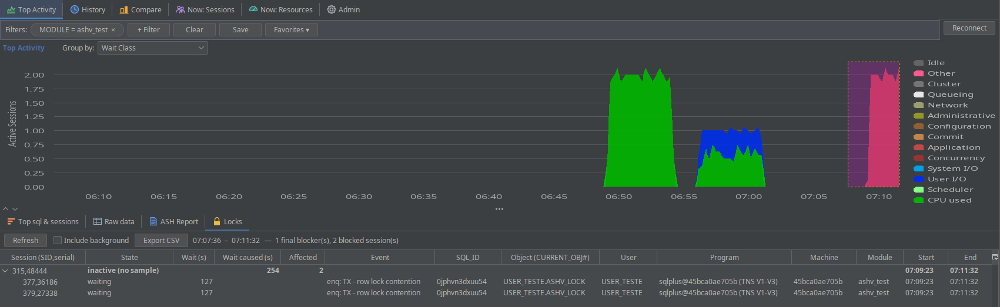
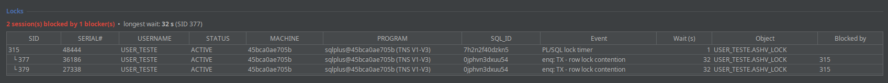
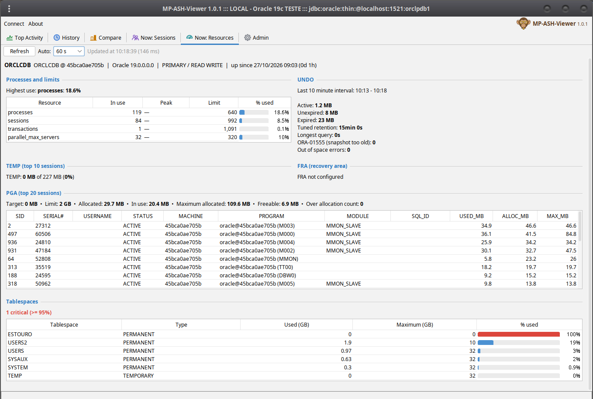
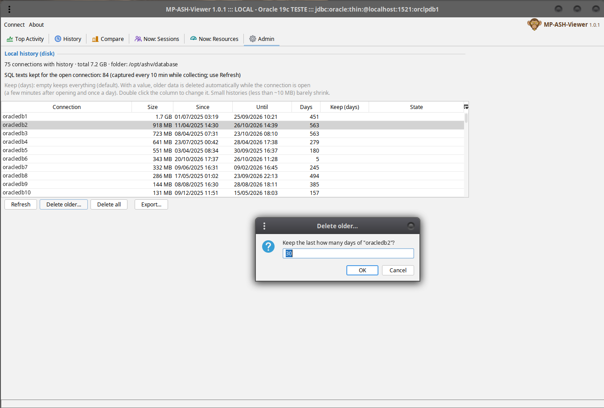
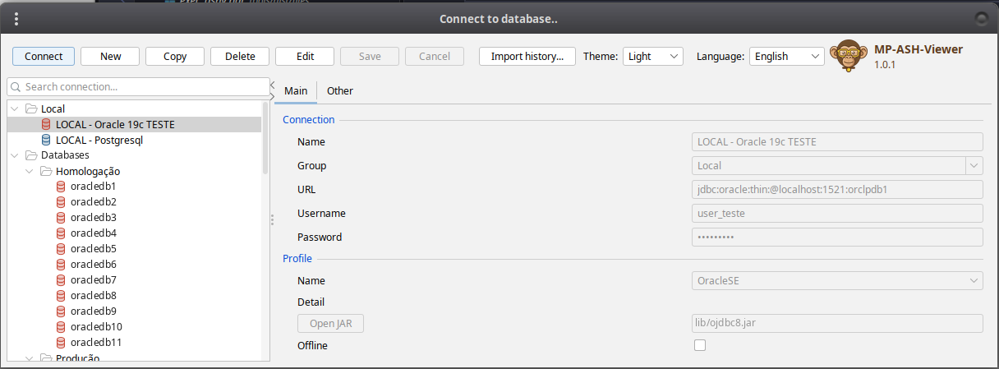

# MP-ASH-Viewer features

- [How it works](#how-it-works)
- [Top Activity](#top-activity)
- [Filters and Group by](#filters-and-group-by)
- [History](#history)
- [Compare](#compare)
- [Locks](#locks)
- [Now: Sessions and Now: Resources](#now-sessions-and-now-resources)
- [Now: OS](#now-os)
- [SQL text and execution plans](#sql-text-and-execution-plans)
- [Admin: disk, purge, backup and import](#admin-disk-purge-backup-and-import)
- [Languages, themes and About](#languages-themes-and-about)
- [Known limits](#known-limits)
- [What the app reads from the database](#what-the-app-reads-from-the-database)

## How it works

- **OracleSE profile** (Standard or Enterprise Edition, no license needed): every second the app reads the active
  sessions of `v$session` (sessions waiting on a non idle event or on CPU) and stores them as one sample.
- **OracleEE profile**: reads `v$active_session_history` instead (Enterprise Edition with the Diagnostics Pack).
- **PostgreSQL**: samples `pg_stat_activity` (collection inherited from the original ASH Viewer; the features below
  were developed for Oracle).
- The samples are stored locally in an embedded Berkeley DB, one folder per connection (`database/<connection>`),
  with aggregates of 15 s and 1 min for the History charts. Nothing is written in the monitored database.

## Top Activity

- Active sessions of the last hour by wait class (a point every ~16 s), updated while the app collects.
- Select a range with the mouse: **Top sql & sessions** shows the SQL_IDs and sessions of that range with the share
  of each wait class, the selected period, and for each SQL_ID the **executions** and **time per execution** (see
  [Known limits](#known-limits)). Double click a SQL_ID or a session for its details.
- **Raw data**: the samples of the range, column by column, exportable to CSV.
- **ASH Report**: the Oracle ASH report of the range (Diagnostics Pack, Enterprise Edition only).
- **Locks**: the blocking tree of the range (see [Locks](#locks)).
- **Reconnect** opens new connections for the collection, for when the network dropped (e.g. a tunnel).

## Filters and Group by

- **+ Filter**: any collected column (WAIT_CLASS, EVENT, SQL_ID, MODULE, USERNAME, MACHINE...), one or more values,
  "equal to" or "not equal to". Filters on different columns are combined with AND. The charts, tables and
  comparisons follow the active filter.
- Right click a value in a table to filter by it. **Favorites** saves a combination of filters.
- **Group by**: the chart by wait class (default) or by a column (top 10 values + Others); double click an area to
  filter by its value.
- **PL/SQL caller** (OracleSE): group by or compare by `PLSQL_ENTRY` to see the SQLs run inside one procedure as one
  block, like the "Top Level SQL" of Enterprise Manager: `OWNER.PACKAGE.PROCEDURE` is the PL/SQL the session called
  first (`plsql_entry_object_id` + `plsql_entry_subprogram_id` of `v$session`). `PLSQL_ENTRY_OBJECT_ID` groups by
  package. The names come from `dba_procedures` (or `all_procedures`), looked up once per package while connected;
  offline the ids are shown. SQL sent directly by the application, without a procedure, is "(empty)".
- **Hide background** (Oracle), next to the Top Activity, History and Compare charts: hides the sessions of the
  background processes (`SESSION_TYPE = BACKGROUND`: DBWn, LGWR, MMON...), which often fill "(empty)" when grouping by
  MODULE or ACTION. It is not one of the filters (Clear and favorites keep it) and the choice is kept for the next
  connections.

## History

- The local history of the connection: choose a period (8 hours, 12 hours, a day, a week, a month or custom); the
  same Top sql & sessions, Raw data and Locks of any range.
- A connection can be opened **Offline**: only its history, without connecting to the database (also used for
  imported backups).

## Compare

Two periods of the local history side by side: **Period A (baseline)** and **Period B (compared)**.

- Shortcuts: yesterday same time, last week, previous period, or the range selected in Top Activity; a chart under
  each period shows it with some time around; select in a chart to change the period.
- **Measure**: *Average* (active sessions: the load of two time windows) or *Total* (DB time: two runs of the same
  work with different durations, e.g. a batch before and after a fix).
- **Summary**: how much B changed, which wait classes caused it and the SQL_IDs that moved most.
- Tables by wait class and by a column (SQL_ID, EVENT, MODULE, ACTION, PROGRAM, USERNAME, MACHINE, session...):
  A, B, an **A × B** bar (A gray, B orange, same scale for all rows), difference (blue up, green down), change, share
  and state (new, gone, up, down, stable).
- **Plan (A → B)**: a SQL_ID that ran with a plan in B not seen in A is flagged (⚠ old plan → new plan).
- **Executions A / B, Time/exec and Cause**: up because of more executions, slower executions or both.
- Double click a row: both charts show that item only.

## Locks

- **Top Activity / History → Locks**: the blocking tree of the selected range: final blockers at the top (also
  inactive ones, which are not sampled), the sessions they block, the wait caused, the event and the object.
- **Now: Sessions → Locks**: the same live, from `v$session`.

## Now: Sessions and Now: Resources

A live view of the database (light queries, manual refresh or automatic every 30 s / 60 s / 5 min, only while the
tab is visible):

- **Sessions**: by type and status, user sessions grouped by user, machine, program or module; locks; sessions
  rolling back and dead transactions recovered by SMON; long operations; running scheduler jobs.

- **Resources**: processes and limits, PGA (target, limit, top sessions), TEMP (use and top sessions), UNDO (last
  10 minutes), tablespaces (with the ones in warning / critical), FRA and Data Guard (when configured).
- Each section says "no permission" when the user cannot read its view; inside a PDB the values are those the PDB
  sees.

## Now: OS

CPU, load and memory of the **server** and the I/O of the database, from views that also exist in Standard Edition
(no pack) and inside a PDB. Same refresh as the other Now tabs; every value is the difference between the last two
refreshes (the first one reads twice, 3 s apart).

- **Server CPU** (`v$osstat`): busy % (user, sys, I/O wait), CPUs / cores / sockets, load against the cores, and the
  CPU of **this database** (`v$sys_time_model`: DB CPU + background CPU) against the CPU busy on the server: is the
  high CPU from Oracle or from something else? Waiting for Resource Manager shows when a resource plan is limiting
  the database.
- **Server memory**: total RAM, free, OS cache, free swap, paging (swap in / out), Oracle SGA and PGA.
- **One chart** with user, sys, I/O wait, idle and load per core of the last hour, one point per refresh. With the
  automatic refresh on, the chart keeps its history while the tab is hidden: only `v$osstat` is read then.
- **Database I/O by function** (`v$iostat_function`): read / write MB/s, I/O per second, average latency and share of
  Buffer Cache Reads, Direct Reads, LGWR, DBWR, RMAN...
- What "this database" means depends on the connection: the instance (non-CDB), **the PDB only** (connected to a
  PDB) or **the whole CDB** (connected to the root, with a table of the CPU of each container; a common user needs
  `CONTAINER_DATA=ALL` to see the PDBs). CPU, load and memory are always of the whole server.
- Not available from the database: file systems, other OS processes and network cards.

## SQL text and execution plans

- The tooltip of a SQL_ID shows its text; right click → "Copy SQL text".
- Every 10 minutes, while collecting, the texts of the SQL_IDs collected are read from `v$sql` (batches of 100) and
  kept in the local history: the text is there later, after the SQL left the shared pool, and when only the history
  is open.
- **SQL details** (double click a SQL_ID), tab "Sql text/plan": one tab per plan hash value, with
  - **Tree**: the plan from `v$sql_plan`, kept in the local history; TABLE ACCESS FULL in bold orange;
  - **DBMS_XPLAN**: the text of `DBMS_XPLAN.DISPLAY_CURSOR` as in SQL*Plus, by child cursor, in three formats:
    *Typical + binds* (predicates, peeked binds, notes such as SQL profile / baseline / adaptive plan),
    *Actual rows* (`ALLSTATS LAST`: A-Rows, A-Time and Buffers when the statement ran with the hint
    `gather_plan_statistics` or `statistics_level = ALL`) and *Advanced* (outline); full table scans highlighted.
    It reads the shared pool, only when the tab is opened; no Oracle pack needed.
- The OracleSE profile also stores the plan hash value and SQL_EXEC_ID of every sample (used by Compare).

## Admin: disk, purge, backup and import

- Every local history with its size, first and last sample.
- **Delete older...** (samples and History aggregates older than N days, then the disk space is given back) and
  **Delete all**; progress bar with elapsed and remaining time, and Cancel.
- **Keep (days)** per connection: automatic purge while the connection is open (empty: keep everything).
- **Export...**: a period of a connection as a `.zip`: a ready Berkeley DB with the samples, aggregates, SQL texts
  and plans of the period, plus `backup.properties` (source connection, profile, period, counts) and the connection
  **without user, password or URL**.
- **Import history...** (connection dialog): into a new connection (group "Imported", opens offline) or one with an
  empty history; into a history with samples only for the connection of the same name and without samples in the
  same period.

## Languages, themes and About

- English (default) and Portuguese, chosen in the connection dialog; numbers and dates follow the language, CSV
  files follow the system (as Excel does).
- Light, dark and classic themes.
- **About**: version, project page, credits and the system information to copy into a bug report.

## Known limits

- **Sampling**: one sample per second. A session active for less than that may not be seen; this is the nature of
  ASH (Oracle's own ASH works the same way).
- **Short executions**: executions shorter than the sampling interval are mostly not seen, and the ones seen look
  like ~1 s each. In a test, 1,440,000 executions of 0.125 ms appeared as 242 "executions". When most executions of
  a SQL are seen in a single sample the app shows **"≥ N"** executions and **"< 1 s"** per execution, and no Cause;
  long executions (several seconds) are counted correctly (test: 80 executions of 3 s in the app, 3.007 s in
  `v$sql`).
- **Top Activity** is a trend view (a point every ~16 s); for what is happening this second use **Now: Sessions**.
- **Oracle RAC**: not supported as a cluster; open one connection per instance.
- **PostgreSQL** (reviewed in 1.2.0): Top Activity, History, Compare, filters, Group by, Top sql & sessions, Raw data,
  SQL text, CSV export and Admin work;
  the Oracle only screens (Now tabs, ASH Report, Locks, execution plans, SQL statistics) are hidden. More PostgreSQL
  features are planned for a next phase.
  **MySQL** is being evaluated.

## What the app reads from the database

| When | Query | Views |
|---|---|---|
| Every second (OracleSE) | active sessions; for the running SQL its plan hash value | `v$session`, `v$sesstat`, `v$mystat`, `audit_actions`, `v$sql` (by SQL_ID + child number) |
| Every 10 min | texts of the SQL_IDs collected, batches of 100 | `v$sql` |
| On demand | SQL text, plan, session and SQL details | `v$sql`, `v$sql_plan`, `v$session` |
| DBMS_XPLAN tab | plan text of a child cursor | `DBMS_XPLAN.DISPLAY_CURSOR` (`v$sql_plan`, `v$sql_plan_statistics_all`) |
| Locks | object names of the ids shown | `dba_objects` (or `all_objects`) |
| Group by / Compare / filter by PLSQL_ENTRY | names of the packages shown, once per package | `dba_procedures` (or `all_procedures`) |
| Now: OS (tab hidden, auto refresh on) | CPU and load for the chart | `v$osstat` |
| Now: OS (refresh) | CPU, load, memory and I/O of the server, CPU by container | `v$osstat`, `v$sys_time_model`, `v$sgainfo`, `v$pgastat`, `v$iostat_function`, `v$con_sys_time_model` + `v$containers` (CDB root) |
| Now tabs (refresh) | sessions, limits, PGA, TEMP, UNDO, tablespaces, FRA, Data Guard, long operations, jobs | see the grants in the [README](../README.md#database-privileges) |
| ASH Report tab | ASH report text | `DBMS_WORKLOAD_REPOSITORY` (Diagnostics Pack) |
| OracleEE profile | samples | `v$active_session_history` (Diagnostics Pack) |
